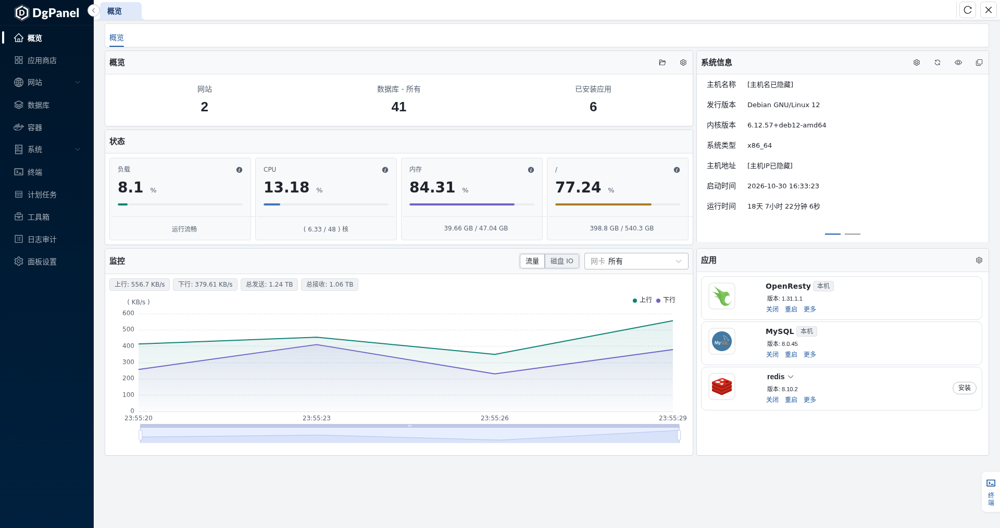
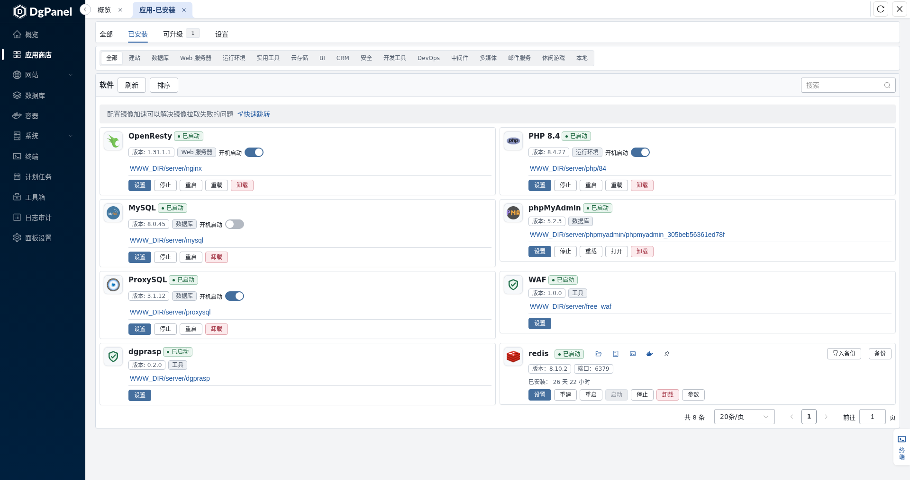

<p align="center"></p>

# DogePanel

通过浏览器管理 Linux 服务器上的网站、PHP、OpenResty、MySQL、Redis、ProxySQL、文件、备份和安全应用。

[新手安装与使用指南](docs/deployment/DogePanel.md) · [dgpctl 数字菜单](docs/dgpctl-menu.md) · [下载最新版本](https://github.com/nickdodo1088/DogePanel-releases/releases/latest) · [English](#english)

## 第一次安装

准备 Linux 服务器，以 root 登录；sudo 用户先执行 `sudo -i`。向维护者索取**安装密码**，用于解密发布包。新部署推荐 Debian 12 / 13，具体应用的版本、架构和安装方式以面板页面为准。

在服务器终端逐行执行：

```bash
mkdir -p dogepanel-install
cd dogepanel-install
curl -fL --proto '=https' -o quick_start.sh https://github.com/nickdodo1088/DogePanel-releases/releases/latest/download/quick_start.sh
bash quick_start.sh
```

按提示输入安装密码，输入不回显属于正常情况。脚本完成下载、校验、解密和安装，结束时显示访问地址、用户名和登录密码，请保存。

默认使用 **HTTPS、自签证书、随机端口和随机安全入口**。云服务器需放行显示的 TCP 端口，浏览器首次访问自签证书会有提示；确认是自己的服务器后继续，登录后可替换证书。安装密码与面板登录密码不同。

缺少 curl 时，Debian 可先执行 `apt-get update`、`apt-get install -y ca-certificates curl openssl`。不需要 Docker 可使用 `bash quick_start.sh --skip-docker`，之后在面板按需安装。安装中断、离线安装、自定义参数及第一次创建网站，见[逐步指南](docs/deployment/DogePanel.md)。

## 升级与账号恢复

已安装的用户可从面板设置中检查更新。升级前先备份，等待重启后重新登录，再检查网站和数据库。也可重新下载并执行上面的 `quick_start.sh`，它会识别现有安装并进入升级。

在服务器 SSH 终端执行 `sudo dgpctl`，默认显示中文数字菜单：

| 编号 | 操作 |
| --- | --- |
| 14 | 查看面板访问地址与账号 |
| 5 / 6 / 8 | 修改密码、用户名或面板端口 |
| 24 | Google 动态密码：二维码、绑定、验证、重新绑定和关闭 |
| 27 / 28 | HTTPS 设置或安全入口 |
| 31 | 面板自检 |
| 32 / 33 | 普通运维限制与管理员 Shell 任务 |
| 34 / 35 | 语言切换与 Debian 每日自动维护 |

可直接输入 `dgpctl 14`、`dgpctl 24`。英文菜单使用 `dgpctl --language en`。完整操作见[命令行菜单](docs/dgpctl-menu.md)；恢复、回退和排查步骤见[部署指南](docs/deployment/DogePanel.md#升级面板)。

Debian 自动维护由管理员首次启用，之后普通包每日更新，无需逐次确认。使用 HTTPS 源和 Debian 官方签名，保留原系统源；排除内核、引导器、固件、initramfs 和 DKMS，不跨大版本升级，不自动重启。

## 实际界面

截图来自真实安装的 DogePanel，未模拟接口响应；主机标识、账号和路径已匿名化。





## 发布附件与源码

| 文件 | 用途 |
| --- | --- |
| `quick_start.sh` | 安装与升级入口，包含该版本文件的校验摘要 |
| `1panel-<版本>-linux-<架构>.tar.gz.enc` | amd64 或 arm64 加密安装包 |
| `dogepanel-<版本>-source.tar.gz.enc` | 该版本完整源码 |
| `aapanel-export-linux-<架构>.enc` | 跨机器迁移 aaPanel 的导出工具 |
| `manifest.json`、`manifest.json.sig` | 文件摘要与签名 |

GitHub 自动生成的 “Source code (zip/tar.gz)” 是本发布仓库的文件；完整面板源码请使用对应版本的加密源码附件。使用同版本入口解密：

```bash
bash quick_start.sh --decrypt dogepanel-<版本>-source.tar.gz.enc
```

`software-*` 和组件更新与面板版本分别管理，不能把软件包当作面板升级包。所有文件均应通过发布入口校验后使用；不要公开安装密码或私钥。

## 来源与许可

DogePanel 基于 [1Panel v2](https://1panel.cn) 二次开发，保留原版权及上游声明，采用 [GPL-3.0](LICENSE)。本仓库中的安装入口、界面和操作说明适用于 DogePanel。文档文件位置采用[相对路径与目录别名](docs/path-conventions.md)。

## English

DogePanel manages Linux websites, PHP, OpenResty, databases and host services. Obtain the installation password from the maintainer, sign in as root and run the commands above. New installations use HTTPS with a self-signed certificate, a random port and a random security entrance. Save the generated login details and allow the displayed TCP port in your cloud firewall.

Run `dgpctl --language en` for the English administrator menu. Menu 24 manages authenticator binding and recovery; menu 35 enables daily Debian maintenance. Automatic maintenance excludes kernels and the boot chain and never reboots. See the [deployment guide](docs/deployment/DogePanel.md) for installation, upgrades and recovery.
